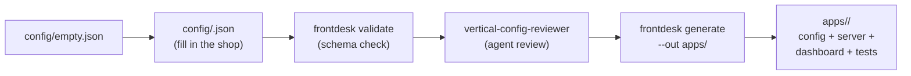

# Design — Add a Vertical

## Overview

Adding a vertical is a five-step pipeline. Four steps are checks; only the
last one writes code, and it is done by the generator, not by hand.



## Components

| Step | Tool | What it checks / produces |
|---|---|---|
| Copy | `cp config/empty.json config/<business>.json` | A valid, minimal starting point |
| Validate | `node template/cli.js validate --config <file>` | Schema conformance (via `template/lib/config.js`) |
| Review | `.kiro/agents/vertical-config-reviewer.md` | Hours, services, intake, estimates, recall, honesty |
| Generate | `node template/cli.js generate --config <file> --out apps/<business>` | The app: config copy, thin server, per-vertical dashboard, smoke test |
| Test | `node --test apps/<business>/tests/` | Boots the app, checks health + dashboard + vertical flow |

## Dashboard selection

The generator picks the dashboard by `business.type`:

| Type | Dashboard | Why |
|---|---|---|
| `auto-repair` | `template/public-auto/` | Estimate-first: symptom → range → book |
| `dental-clinic` | `template/public-dental/` | Recall-first: 180-day recalls on top |
| anything else (vet, salon, cafe, other) | `template/public/` | Generic dashboard, rendered from the config |

A new dedicated screen for a type is a new `template/public-<type>/`
folder plus one line in `dashboardDirFor()` in `template/generate.js`.

## Data model

No new data model. A generated app stores bookings and the outbox in
`apps/<business>/data/<slug>.json` (JSON snapshot, gitignored). The vet
clinic's 365-day recall is just `reminders.recallDays: 365` in its config —
the existing recall engine (`template/lib/reminders.js`) already handles any
recall length.

## Worked example: Paws & Claws Veterinary Clinic

Input: `config/paws-vet.json` (vet-clinic, 4 services, 365-day recall).

Expected output of `frontdesk generate --config config/paws-vet.json --out apps/paws-vet`:

```
apps/paws-vet/
├── config.json            # copy of the vet config
├── server.js              # thin wrapper, publicDir = apps/paws-vet/public
├── package.json           # frontdesk-paws-claws-veterinary-clinic
├── README.md
├── public/                # generic dashboard (no vet screen yet)
│   ├── index.html
│   ├── dashboard.js
│   └── styles.css
└── tests/
    └── smoke.test.js      # health + dashboard + vertical flow
```

Expected runtime behavior: `/api/health` returns
`{"business": "Paws & Claws Veterinary Clinic", "type": "vet-clinic"}`;
`/api/slots` follows the clinic's 08:00–18:00, Mon–Sat hours; a completed
visit 400 days ago appears in `/api/reminders` recalls with
`daysSince >= 365`.

## Correctness

- The generator never edits `template/`; it only reads it.
- The generated app never duplicates template code; its `server.js` requires
  `../../template/server`.
- Every date/time comparison in the generated app goes through the
  business-timezone wall-clock helpers (`template/lib/reminders.js`,
  `template/lib/booking.js`). Never parse a booking date with a bare
  `new Date()` — that was the Day 1 timezone bug and the Day 2 closed-day
  bug, both caught by tests.
