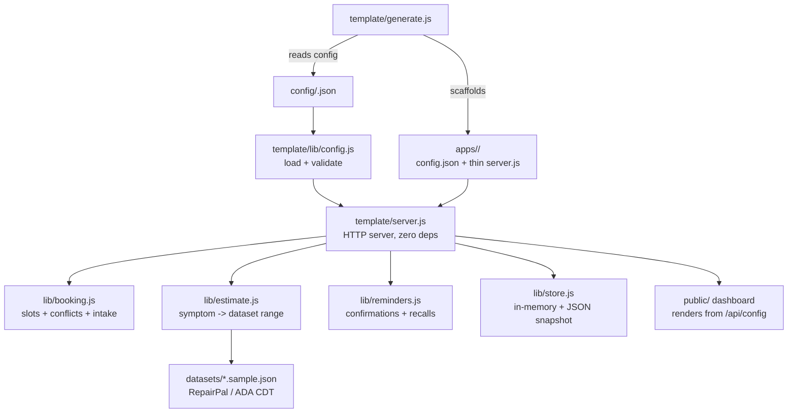

# Design Document — FrontDesk Template

## Overview

One JSON config describes a business. A zero-dependency Node server reads the
config and becomes that business's front desk. A generator scaffolds a runnable
app directory per config. Two configs (auto repair, dental) prove the template
is versatile; a third vertical (vet clinic) is generated live in the demo
video to prove it generalizes.

## Architecture



## Components

| Component | File | Responsibility |
|---|---|---|
| Config loader | `template/lib/config.js` | Parse + validate a config against `config/schema.json`. Hand-rolled validator, no dependency. Rejects bad configs with the field named. |
| Booking engine | `template/lib/booking.js` | 30-minute slot grid from business hours; overlap detection; intake validation (including the dental new-patient rule). |
| Estimate engine | `template/lib/estimate.js` | Keyword match of a symptom against the named dataset; returns the dataset range verbatim with source + disclaimer. Never invents a price. |
| Reminders | `template/lib/reminders.js` | Confirmations due within `confirmHoursBefore`; recalls due after `recallDays` since the last completed visit. Computed from bookings only. |
| Store | `template/lib/store.js` | In-memory bookings + outbox; JSON snapshot in `./data/<slug>.json`, rewritten on every mutation. Delete the file to reset the demo. |
| Server | `template/server.js` | Node `http` only. Serves the dashboard and a JSON API. No framework, no build step, no login. |
| Dashboard | `template/public/` | Static HTML/CSS/JS. Renders services, intake fields, and estimate UI from `/api/config`, so the same page serves every vertical. |
| Generator | `template/generate.js` | Validates a config, scaffolds `apps/<business>/` (config copy, thin `server.js` wrapper, package.json, README, smoke test). Day 1 skeleton; Day 2 adds per-vertical screens and deploy wiring. |

## Data Model

### Booking

```json
{
  "id": "bk_9f2c41a0",
  "serviceId": "oil-change",
  "date": "2026-11-12",
  "startTime": "10:00",
  "customerName": "Test Driver",
  "phone": "+15550199",
  "intake": { "vehicleYearMakeModel": "2019 Honda Civic", "mileage": 82000, "symptomDescription": "due for service" },
  "channel": "sms",
  "status": "booked",
  "reminderSent": false,
  "createdAt": "2026-11-10T05:00:00.000Z"
}
```

Status is `booked` | `completed` | `cancelled`. Only `booked` blocks a slot.
A past booking with status `completed` is how the recall engine finds patients.

### Outbox entry (simulated send)

```json
{ "id": "msg_...", "to": "+15550199", "channel": "sms", "kind": "confirmation",
  "body": "Hi ..., this is FixIt Auto. ...", "sentAt": "...", "simulated": true }
```

Sends are simulated in the template and labeled as such. A real deployment
wires Twilio at `store.sendMessage` — the template never claims a real SMS
was placed.

## API

| Method | Path | Description |
|---|---|---|
| GET | `/` | Owner dashboard (HTML) |
| GET | `/api/health` | `{ ok, business, type, version }` |
| GET | `/api/config` | The loaded config (public fields) |
| GET | `/api/services` | Services + dataset citation |
| GET | `/api/slots?date=&serviceId=` | Free start times (30-min grid) |
| POST | `/api/bookings` | Create a booking (409 SLOT_TAKEN, 400 INTAKE_INCOMPLETE) |
| GET | `/api/bookings?date=` | List bookings |
| GET | `/api/bookings/:id` | One booking |
| POST | `/api/bookings/:id/cancel` | Cancel (frees the slot) |
| POST | `/api/estimate` | Symptom → price/time range (auto only) |
| GET | `/api/reminders` | Confirmations + recalls due |
| POST | `/api/reminders/send` | Simulated confirmation send |
| POST | `/api/recalls/send` | Simulated recall send |
| GET | `/api/outbox` | Simulated sent messages |

## Config Schema

`config/schema.json` (JSON Schema draft-07, documented in the file). The two
shipped configs follow schema v0 exactly, extended only with `business.hours`
(open/close/days) and `business.phone`/`address`, which the booking engine
needs. Differences that make the verticals distinct live only in config:

| | FixIt Auto | BrightSmile Dental |
|---|---|---|
| Estimate | enabled (RepairPal dataset) | disabled |
| Intake | vehicle, mileage, symptom | name, DOB, insurance, health history, new-patient flag |
| Reminders | confirm 24h, no recall | confirm 24h, recall 180 days |
| Services | priced ranges | CDT codes, no prices |

## Datasets

- `datasets/auto-repair-estimates.sample.json` — RepairPal Fair Price
  Estimator, September 2026. National average ranges, not quotes.
- `datasets/ada-procedure-codes.sample.json` — ADA CDT 2026 codes for the
  most commonly billed general-dentistry procedures. CDT © ADA.
- `datasets/README.md` — the sourcing decision, honest limits, and what a
  full proprietary dataset would replace.

## Error Handling

- Bad config: process exits with `Invalid config: <field>`; nothing is
  generated and nothing is served.
- Unknown service / missing fields: HTTP 400 with a machine-readable `error`
  code (`UNKNOWN_SERVICE`, `MISSING_FIELDS`, `INTAKE_INCOMPLETE`).
- Taken slot: HTTP 409 `SLOT_TAKEN`.
- Estimates disabled: HTTP 400 `ESTIMATES_DISABLED`.
- Corrupt data snapshot: the store starts empty instead of crashing.

## Testing Strategy

- `node --test "template/tests/*.test.js"` — zero-dependency `node:test` suites:
  - `smoke.test.js`: config validation, slot conflicts, estimate matching,
    intake rules, reminder/recall computation, HTTP booking flow incl. 409.
  - `generator.test.js`: config in → app out; generated files exist; invalid
    config rejected.
- Generated apps carry their own `tests/smoke.test.js` (health endpoint).
- Day 2 adds: one property-based test with a caught bug if one is found,
  plus the judges-run check (both apps boot with no login).

## Non-Goals (Day 1)

- Real Twilio voice/SMS (simulated in the template; wired at deploy time).
- Payments, insurance verification, or real patient records.
- Multi-location, multi-staff scheduling (one front desk per app).
