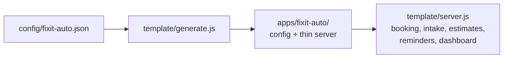

# FrontDesk — a config-driven AI front desk template

**Kiroween 2026 · Skeleton Crew ($5K) + Best Startup ($10K) · a FenBig product**

One JSON config describes a local business. FrontDesk turns that config into
a working front desk app: a missed call or text becomes a booking, intake is
collected, reminders go out, and the owner watches it all on a dashboard.
Two apps prove the template is versatile; a third vertical is generated live
in the demo video to prove it generalizes.

| App | From the same template | Proves versatility with |
|---|---|---|
| **FixIt Auto** (`apps/fixit-auto/`) | Booking + reminders + dashboard | **Dynamic repair estimates** — symptom → price/time range from a named dataset |
| **BrightSmile Dental** (`apps/brightsmile-dental/`) | Booking + reminders + dashboard | **New-patient intake** (insurance + health history) + **180-day recall reminders** |

## Run it in under a minute

No dependencies. No build step. No login. Node >= 20.

```bash
# The template core, running as FixIt Auto
node template/server.js --config config/fixit-auto.json --port 3000
# Dashboard: http://localhost:3000/

# Or run a generated app directly
node apps/fixit-auto/server.js --port 3001
node apps/brightsmile-dental/server.js --port 3002
```

## How config becomes an app



Every difference between the two apps lives in **one file each** —
`config/fixit-auto.json` vs `config/brightsmile-dental.json` (see
`config/schema.json` for the contract). The template core never changes
between verticals:

| | FixIt Auto | BrightSmile Dental |
|---|---|---|
| Estimate | enabled (RepairPal dataset) | disabled |
| Intake | vehicle, mileage, symptom | name, DOB, insurance, health history, new-patient flag |
| Reminders | confirm 24h, no recall | confirm 24h, recall every 180 days |
| Services | priced ranges | ADA CDT codes, no prices |

Generate an app yourself:

```bash
node template/generate.js --config config/fixit-auto.json --out apps/fixit-auto
```

## Repo layout

```
.kiro/                  # Kiro spec, steering, hooks — evidence of deep Kiro use
  specs/frontdesk-template/   requirements.md, design.md, tasks.md
  steering/                   product.md, tech.md, structure.md
  hooks/                      test-after-task, verify-on-save, session-start
config/                 # schema.json + one JSON per business
datasets/               # named, sourced sample datasets + README
template/               # the reusable core (lib, public dashboard, tests)
apps/                   # generated apps, one folder per vertical
docs/                   # verification logs
```

## Kiro workflow

This project is built spec-first with Kiro:

- **Spec** — `.kiro/specs/frontdesk-template/`: requirements (EARS format),
  design (architecture, data model, API), tasks (Day 1 done, Day 2/3 queued).
- **Steering** — `.kiro/steering/`: product rules (100% new code, English
  only, no fabricated data), tech rules (zero dependencies, no build step),
  structure rules (where things go).
- **Hooks** — `.kiro/hooks/` (v1 schema, IDE 1.0 / CLI V3): run the test
  suites after every spec task (`PostTaskExec`), syntax-check JS on save
  (`PostFileSave`), restate the ground rules at session start
  (`SessionStart`).
- **Workflow log (Day 1, 2026-11-10):** spec written → config schema v0 →
  datasets sourced and cited → template core built → generator skeleton →
  tests green → live verification (see `docs/verification-day1.md`).

## Datasets — named, sourced, honest

Innovation here is not "config swap". Each vertical executes on a **named
dataset with a real source**:

- **Auto repair** — RepairPal Fair Price Estimator, September 2026
  (oil change $160–$188, brake pads $335–$394, starter $565–$796,
  alternator $809–$1,088). National averages, **not a quote**. The full
  repair-manual dataset (Mitchell / ALLDATA) is proprietary and not included;
  a shop swaps in its own price book.
- **Dental** — ADA CDT 2026 procedure codes (D0120, D0150, D0274, D1110,
  D2391, D2740, D4341, …). CDT codes © American Dental Association. Fee
  ranges are typical US ranges (ADA Survey of Dental Fees 2024/2025) and
  vary by region — **not a quote**.

Full sourcing decision: `datasets/README.md`. No fabricated row is presented
as real data anywhere in this repo.

## Provenance — 100% new code

- All code in this repo was written new in the Kiroween submission window
  (opened 2026-10-30). **No file was copied from FenBig, AgentMart, or
  WEPOS** — only domain knowledge (missed-call → booking, learned from those
  products) was reused.
- Frameworks/starters used: **none**. The template is Node built-ins only
  (`http`, `fs`, `path`, `crypto`) plus `node:test`. Nothing to disclose
  beyond that.
- License: MIT. `/.kiro` is at the repo root and is never gitignored.

## Best Startup

FrontDesk is a product of **FenBig** (fenbig.com) — founder TRINH VAN PHUC.
The template is the foundation of FenBig's done-for-you front desk setup
service for US local businesses: a shop's config in, a working front desk
out, managed month to month.

## Roadmap

- **Day 1 (done):** repo + spec + configs + datasets + template core +
  generator skeleton + tests green + live verification.
- **Day 2:** full generation of both apps, per-vertical dashboard screens,
  deploy live, property-based test, custom agent/Power, second surface.
- **Day 3:** pilot with 3 real people, demo video (< 3 min), submit early.

## Tests

```bash
node --test "template/tests/*.test.js"
```
